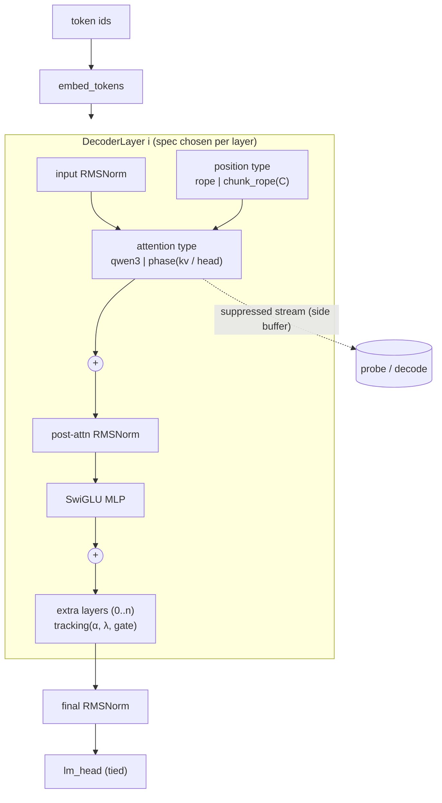
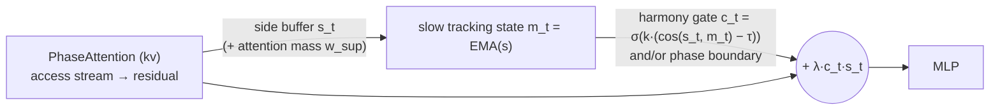

# Architecture: Qwen3-0.6B with new layer types (zero-training surgery)

The main track is now a **from-scratch Qwen3 model definition** (`qwen_arch/`). It loads the pretrained `Qwen/Qwen3-0.6B` weights, and each layer can swap in or add new layer types. Nothing is trained.

With every new layer disabled, the model is **bitwise identical** to HF `Qwen3ForCausalLM`: `torch.equal` holds on the logits in fp32 with SDPA. The test `test_real_qwen3_bitwise_equal_to_hf` checks this.

The earlier tiny-model prototype is described in [ARCHITECTURE_TINY.md](ARCHITECTURE_TINY.md) and is paused.

## Per-layer spec and registries

```python
rules = [
  {"layers": "8-19",        "attention": {"type": "phase", "mode": "kv", "period": 4, "gain": 2.0, "supp": 1.0}},
  {"layers": "14-27",       "position":  {"type": "chunk_rope", "chunk": 4}},
  {"layers": "every4@8-19", "extra":     {"type": "tracking", "alpha": 0.9, "lam": 0.05, "gate": "harmony"}},
]
model = PhaseQwen3ForCausalLM.from_pretrained("Qwen/Qwen3-0.6B", rules=rules)
```

* **Layer selectors:** `all`, `none`, `8-19`, `0,4,8`, `every4`, `every4@8-19`. Later rules override earlier ones, and `extra` layers are appended.
* **Registries** (`qwen_arch/registry.py`): there are three, for `attention`, `position` and `extra`. A new type is added with `@register(kind, name)`, then selected by name in a rule.
* **Generation:** the model has its own KV cache. Phase masks use absolute positions, and the tracking state is carried in the cache. Tests check that cached decoding equals the full forward pass for every layer type.

## Diagram



## New layer types

### 1. PhaseAttention (`attention.type = "phase"`)

This is a drop-in replacement that reuses the pretrained `q/k/v/o_proj` and `q_norm/k_norm`. The same heads time-multiplex between two content streams on a fixed period P, with phase(t) = ⌊t/P⌋ mod 2.

* **`mode="kv"` (key/value phases):** key s belongs to phase(s). For a query at time t, keys in its own phase form the **access** stream and the other keys form the **suppressed** stream:

  `y = softmax(QKᵀ/√d + log(gain)·[access] + log(supp)·[suppressed]) · V`

  | Setting | Effect |
  |---|---|
  | `gain=supp=1` | exactly stock attention (a mathematical identity) |
  | `gain>1` | gain boost to the access stream (the preprint reports higher gain in conscious epochs) |
  | `supp=0` | only the access stream writes to the residual |

  The suppressed stream's own output, `softmax over suppressed keys only · V`, is stored in `attn.buffer["suppressed"]`.
* **`mode="head"` (head-group alternation):** heads 0–7 (KV heads 0–3) and heads 8–15 (KV heads 4–7) take turns having access every P tokens. The access group's output is scaled by `gain` and the other group's by `supp`, and the suppressed group's output goes to the buffer. `gain=supp=1` is stock.
* **`out_gain`** scales the whole attention write.

### 2. ChunkRoPE (`position.type = "chunk_rope"`)

* Token t gets RoPE position ⌊t/C⌋·C (`scale="keep"`) or ⌊t/C⌋ (`scale="compress"`).
* Relative positions therefore only encode order *between* chunks. Inside a chunk, order is visible only through the causal mask. This is the token analogue of locally time-reversed speech staying intelligible.
* C=1 is stock.
* The evaluation reverses tokens inside chunks with `chunk_reverse` and scores only chunk-end targets.

### 3. Tracking layer (`extra.type = "tracking"`)

This layer is inserted after a decoder layer, after Tsao's "drone" analogy: a continuous slow state that phase content couples to.

* The state m_t is a causal, bias-corrected EMA of the residual over earlier positions. It excludes t itself and skips the attention sink at position 0.
* The update is `h_t ← h_t + λ·c_t·(m_t − h_t)`, where the gate c_t is one of:

  | Gate | Rule |
  |---|---|
  | `harmony` | `sigmoid(k·(cos(h_t, m_t) − τ))`: couple only when consistent with the tracked state |
  | `always` | 1 |
  | `phase` | couple on alternate micro-epochs only |

* λ=0 is the identity.

### 4. Suppressed-stream feedback through tracking (`extra.type = "suppressed_tracking"`)

This feeds the hidden stream back through the tracking layer. PhaseAttention in `kv` mode **exposes** its suppressed-stream side buffer to any coupling layer in the same decoder layer. Exposure is switched on automatically, and only when such a layer has λ≠0.



`coupling` sets what is fed back and where:

| coupling | Signal | Where | Notes |
|---|---|---|---|
| `restore` | `o_proj(y_stock − y_actual)`: the suppressed stream's content at its **stock attention share**, from the buffer and its partition mass | between attention and MLP | λ=1 with c=1 recovers stock attention exactly (tested). The slow state m_t = EMA(side) only drives the harmony gate. |
| `inject` | EMA of the raw suppressed output, added back | after the MLP | |
| `pull` | the tracking state absorbs the buffer, `u = h + mix·(‖h‖/‖s‖)·s`, and the residual is pulled toward it, `h += λ·c·(m − h)` | after the MLP | |

**Gates:**

| Gate | Rule |
|---|---|
| `harmony` | the current suppressed content agrees with the tracked state; for `pull`, also the current token |
| `boundary` | first token of each phase micro-epoch |
| `either` / `both` | max / product of `harmony` and `boundary` |
| `always` | 1 |
| `bernoulli(p)` | random gate with a matched duty cycle (control) |

**Controls:** `source="random"` (norm-matched noise), `source="shuffled"` (a causal buffer from a random earlier position), `source="none"` (tracking only).

**Exactness:** λ=0 is bitwise identical to stock HF, which is tested on the real model.

### 5. Trainable new layers (frozen base) — `"trainable": true`

Any new-layer spec can take `"trainable": true`. Then **only the new-layer parameters** get gradients. All Qwen3-0.6B
weights stay frozen and are shared with the stock teacher (`scripts/train_new_layers.py`). Every parameter is
initialised so that the trainable layer starts *exactly* at its untrained (zero-training) behaviour. Gain/supp
are log-parametrised and rates are logit-parametrised. The adapter up-projection is zero-initialised. Tests
check that it matches the frozen version at init, that strength 0 is still bitwise stock, that the cache is
equivalent, and that gradients flow.

| layer | trainable parameters (per layer) |
|---|---|
| PhaseAttention (kv) | `log_gain[H]` (access bias), `log_supp[H]` (suppressed bias, only with `train_supp`; hard supp=0 stays fixed at −inf), `log_out[H]` (per-head output gain). With `learn_phase`: `phase_offset`, `log_period`, `log_psharp` give a soft, differentiable phase `½(1 − tanh(k·sin(π(t+½+φ)/P)))` in place of ⌊t/P⌋ mod 2 |
| suppressed_tracking | `lam_p` (strength), `mix_p`, `alpha_logit` (EMA rate), `tau_p` (harmony threshold), `log_sharp` (sharpness). With `adapter_rank=r`: a low-rank D→r→D adapter on the fed-back signal (2·D·r params) |
| tracking | `lam_p`, `alpha_logit`, `tau_p`, `log_sharp` |
| ChunkRoPE | `blend_logit`: positions = (1−β)·t + β·chunk_pos, β = σ(blend_logit), init from `blend` |

Loss: `KL(stock ‖ student) + lm_w·CE + gate_w·mean(gate)`, with lm_w = 0.2. Data: WikiText-2 **train** split only.
Results and caveats are in `RESULTS_TRAINED.md`.

**Outcome (RESULTS_TRAINED.md):** with a frozen base, the trainable phase knobs drift back toward the identity.
Restore gates open fully (gw = 0), soft-phase sharpness collapses, gain/supp equalise, the ChunkRoPE blend falls.
Phase arms are worse than, or tied with, knob-matched identity controls (`CTRL_identity_trainable`, `CTRL_identity_small`).

### 6. Retention reward (RESULTS_RETENTION.md)

`scripts/train_retention.py` adds a per-lag readout: Linear(D, 64) → 2049 classes on the residual after layer 19.
Its loss rewards decoding token[t−k] for suppressed-phase lags k ∈ {4, 12, 28, 60}. It trains jointly with the new
layers (frozen base). It is evaluated alongside a fresh ridge probe fit on train windows. Result: no advantage over
matched identity / stock controls. The restore gate still opens fully and the soft-phase sharpness still collapses.
