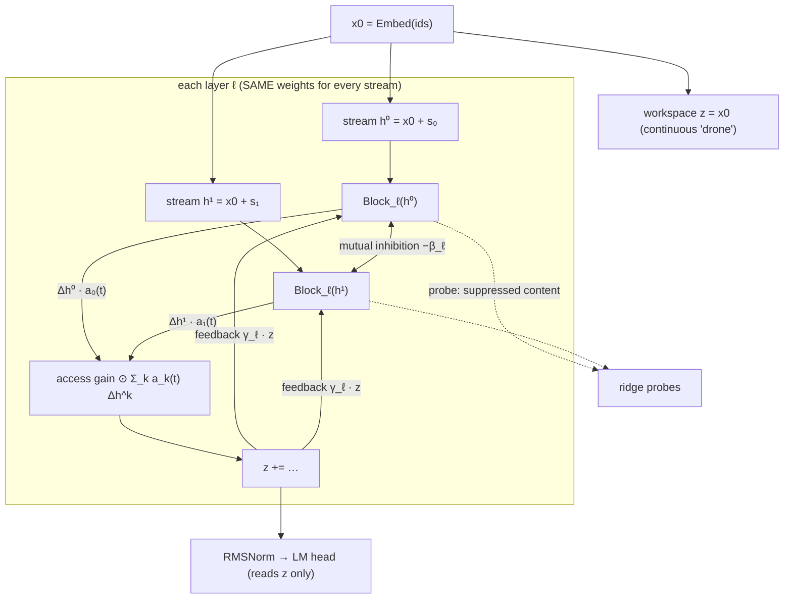

# Architecture

## 1. Baseline block with a swappable attention interface

```
ids ──► MultiEmbedding (sum over channels; 2 channels = left/right eye)
        │
        ▼
   ┌──────────── Block × L ────────────┐
   │ x = x + Attention(RMSNorm(x), rope)│  ◄── ATTENTION_REGISTRY[cfg.attention]
   │ x = x + SwiGLU(RMSNorm(x))         │
   └────────────────────────────────────┘
        │
        ▼
   RMSNorm ─► tied LM head
```

* The `Attention` interface is `forward(x: (B,T,D), rope: RotaryEmbedding) -> (B,T,D)`.
* `causal`: standard multi-head attention with RoPE, using `scaled_dot_product_attention`. This is the baseline.
* `phase_mask`: an ablation. A query in phase k = ⌊t/P⌋ mod K only attends to keys in phase k. It has the same parameters and FLOPs as the baseline.
* **To update the attention later:** subclass `Attention`, add `@register_attention("my_attn")` and set `ModelConfig(attention="my_attn")`.
* `RotaryEmbedding(chunk=C)`: **CoarseRoPE**. Token t gets position ⌊t/C⌋, so positions only encode order *between* chunks.

## 2. PhaseLM: phase-alternating multi-stream prototype (PhaseAttention v0)



* **Phase schedule `a[b,k,t]`:**

  | Schedule | Rule | Role |
  |---|---|---|
  | `fixed` | stream ⌊t/P⌋ mod K has access | the hypothesis |
  | `random` | each P-length micro-epoch goes to a random stream | control |
  | `all` | weight 1/K for every stream | no-phase control |
  | `learned` | straight-through hard gate from the embedding | v1 |

* **Same population:** the streams share every block weight, the way the same IT neurons carry both faces.
* **Access with gain:** only the access stream's per-layer update enters `z`, scaled by a learned per-channel gain. This mirrors the amplified tuning in conscious epochs.
* **Continuity:** `z` never resets when the phase switches, and every stream reads it back (Tsao's "drone" analogy).
* **Suppressed but decodable:** the non-access stream keeps being updated, and ridge probes on `h^k` and on `z` measure what is decodable.
* **Cost:** K× the block FLOPs. Extra parameters are K·D + D + 2L, about 0.05% of the model.
* **Unit test:** `test_only_access_stream_reaches_head` checks that a perturbation of stream 1 only changes logits during stream 1's access epochs (with inhibition off).

## 3. Local time-reversal (chunk) module

* `chunk_reverse(x, C)` reverses tokens *inside* consecutive length-C chunks and keeps the chunk order. This is the token analogue of the 20–50 ms speech manipulation.
* The evaluation scores only targets at chunk ends (t mod C = C−1), whose visible context is made of whole chunks. It compares bpb with intact context against bpb with locally reversed context. The ratio measures robustness.
* `CoarseRoPE(C)` is the architectural variant, and `coarse4` in the training script uses it.
